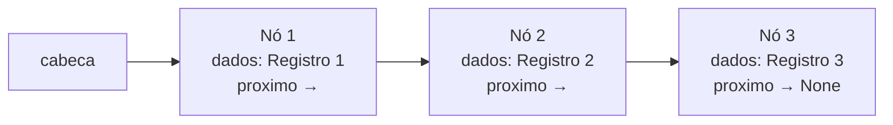

# Colabre — Citizen Assist AI

Projeto da disciplina **Data Structures and Algorithms (DSA)** — FIAP, feito em
**Python 3.10+**.

## 1. Recorte

**Colabre** é um banco de tempo e serviços comunitários. Cada registro é uma
**Oferta** de ajuda, um **Pedido** de ajuda ou um **Projeto** comunitário, e
**1 hora de ajuda equivale a 1 crédito**.

O problema: organizar, consultar, atualizar, excluir, pesquisar e ordenar as
ofertas, pedidos e projetos da comunidade, permitindo que o cidadão encontre
ajuda e se reconheça como parte da rede.

O cidadão atendido: qualquer morador da comunidade que queira oferecer
conhecimento/tempo (ex.: aulas de reforço, consertos, culinária, horta) ou
precisa pedir ajuda.

Sobre o nome: o **"AI"** é um **assistente de organização e busca** — ele
estrutura os dados em uma lista encadeada e localiza registros. **Não** é usada
IA generativa.

## 2. Como executar

Requisito: **Python 3.10 ou superior**.

```bash
python main.py
```

Funciona em **Windows** e **Linux** (o projeto só usa a biblioteca padrão).

Ambiente virtual (opcional):

```bash
python -m venv .venv
# Windows
.venv\Scripts\activate
# Linux
source .venv/bin/activate
python main.py
```

Testes (quando existirem):

```bash
python -m unittest -v
```

## 3. Estrutura de pastas

```
.
├── main.py            # ponto de entrada
├── registro.py        # classe Registro
├── lista.py           # classes No e ListaEncadeada
├── algoritmos.py      # busca linear e Selection Sort
├── menu.py            # menu, leituras e validações
└── docs/
    ├── algoritmos.md  # busca linear e Selection Sort
    └── testes.md      # plano e evidências de teste
```

## 4. Modelo dos registros

A classe `Registro` (em `registro.py`) tem os campos abaixo.

| Campo | Tipo | Obrigatório | Validação |
|-------|------|-------------|-----------|
| `id` | `int` | Sim | Único; não negativo (`minimo=0`); `0` cancela o cadastro |
| `titulo` | `str` | Sim | Não vazio; até 100 caracteres |
| `tipo` | `str` | Sim | `Oferta`, `Pedido` ou `Projeto` (aceita qualquer caixa, ex.: `"oferta"`, `"PEDIDO"`) |
| `categoria` | `str` | Sim | Não vazio; até 50 caracteres |
| `descricao` | `str` | Sim | Não vazio; até 200 caracteres |
| `requisitos` | `str` | Sim | Não vazio; até 150 caracteres |
| `local` | `str` | Sim | Não vazio; até 100 caracteres |
| `horas` | `int` | Sim | Inteiro maior que zero |
| `responsavel` | `str` | Sim | Não vazio; até 60 caracteres |

Exemplo de 3 registros:

| ID | Título | Tipo | Categoria | Horas | Responsável |
|----|--------|------|-----------|-------|-------------|
| 1 | Aula de reforço de matemática | Oferta | Educação | 2 | Ana |
| 2 | Consertar torneira da cozinha | Pedido | Manutenção | 1 | Maria |
| 3 | Horta comunitária na praça | Projeto | Horta | 4 | Carlos |

## 5. Lista encadeada

Os registros ficam **exclusivamente** em uma lista encadeada simples,
implementada em `lista.py`:

- `No` — guarda `dados` (um `Registro`) e a referência `proximo` para o próximo
  nó (`None` no fim).
- `ListaEncadeada` — guarda `cabeca` (primeiro nó) e `tamanho` (quantidade de
  nós). **Não** tem referência para a cauda.

Operações:

| Operação | Descrição |
|----------|-----------|
| `inserir_fim(registro)` | Insere um nó no fim, percorrendo a lista |
| `imprimir_lista()` | Percorre os nós e exibe cada registro |
| `remover_por_id(id)` | Remove o nó com o ID informado |
| `buscar_por_id(id)` | Retorna o registro com o ID ou `None` |
| `limpar()` | Zera a lista, desligando cada nó |
| `__len__()` | Retorna `tamanho` |

Diagrama:



### Integridade na remoção

A remoção é feita movendo as referências e **desligando o nó removido**
(`proximo = None`), sem quebrar a cadeia:

- **Cabeça:** `cabeca` passa a apontar para `cabeca.proximo`; o nó removido tem
  `proximo = None`.
- **Meio:** `anterior.proximo` recebe `atual.proximo`; o nó removido tem
  `proximo = None`.
- **Fim:** `anterior.proximo` recebe `None` (o `proximo` do nó removido); o nó
  removido tem `proximo = None`.

Em todos os casos, `tamanho` é decrementado e os demais nós permanecem ligados.

## 6. Menu

Menu principal (em `menu.py`):

| Opção | O que faz | Validações | Função chamada |
|-------|-----------|------------|----------------|
| 1 | Cadastrar registro | ID único e não negativo; campos obrigatórios e com limite; tipo válido; horas > 0; `0` cancela | `cadastrar_registro` |
| 2 | Consultar por ID | Lista não vazia; ID inteiro | `consultar_por_id` |
| 3 | Pesquisar por título ou categoria | Lista não vazia; opção 0–2; termo não vazio | `pesquisar` |
| 4 | Atualizar registro | Lista não vazia; ID inteiro; novos valores revalidados; `Enter` mantém o valor | `atualizar_registro` |
| 5 | Excluir registro | Lista não vazia; ID inteiro; confirmação `s/n` | `excluir_registro` |
| 6 | Ordenar e exibir | Lista com 0 ou 1 registro é avisada; opção 0–3 | `ordenar_e_exibir` |
| 7 | Análise | Lista não vazia; conta registros, horas e categorias | `analise` |
| 0 | Sair | — | `executar_opcao` |

A opção do menu é lida por `ler_opcao_menu()`, que aceita apenas **0 a 7** e
rejeita texto, vazio ou número fora da faixa com a mensagem
`"Opção inválida. Digite um número de 0 a 7."`.

## 7. Documentação

- [Algoritmos: busca linear e Selection Sort](docs/algoritmos.md)
- [Testes](docs/testes.md)
